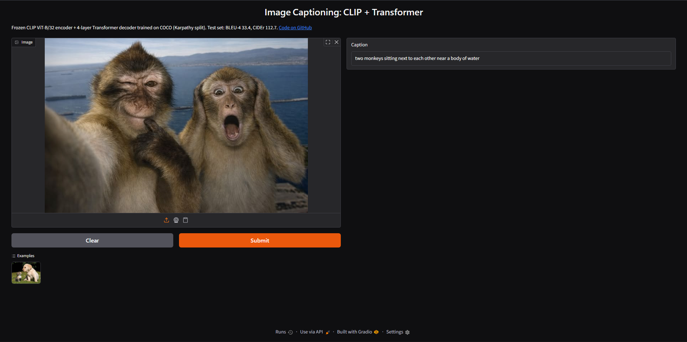

# Image captioning demo

Upload an image and get a caption from a frozen CLIP ViT-B/32 encoder + 4-layer Transformer decoder
trained on COCO (Karpathy split). Test scores: BLEU-4 33.36, METEOR 28.15, CIDEr 112.67.



## Run locally

The weights (110 MB) are too big for GitHub, so they are on Hugging Face. From the repo root:

```bash
pip install -r demo/requirements.txt
hf download vexyiwnl/image-captioning caption_model.pt --local-dir demo
python demo/app.py                  # then open http://127.0.0.1:7860
```

If you trained the model yourself, you can create `caption_model.pt` from the notebook's checkpoint instead of downloading it:

```bash
python -c "import torch; c = torch.load('checkpoints_coco/best_model.pt', map_location='cpu', weights_only=True); torch.save({k: c[k] for k in ('model', 'vocab', 'model_config', 'clip_name')}, 'demo/caption_model.pt')"
```
